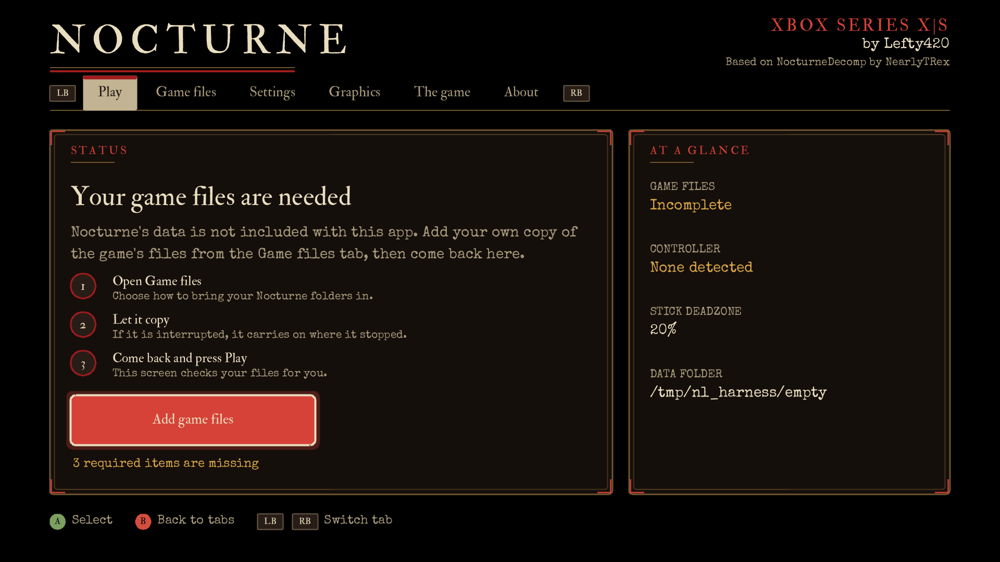
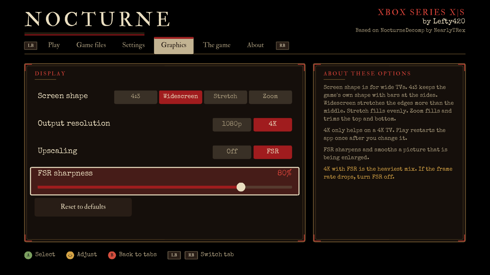
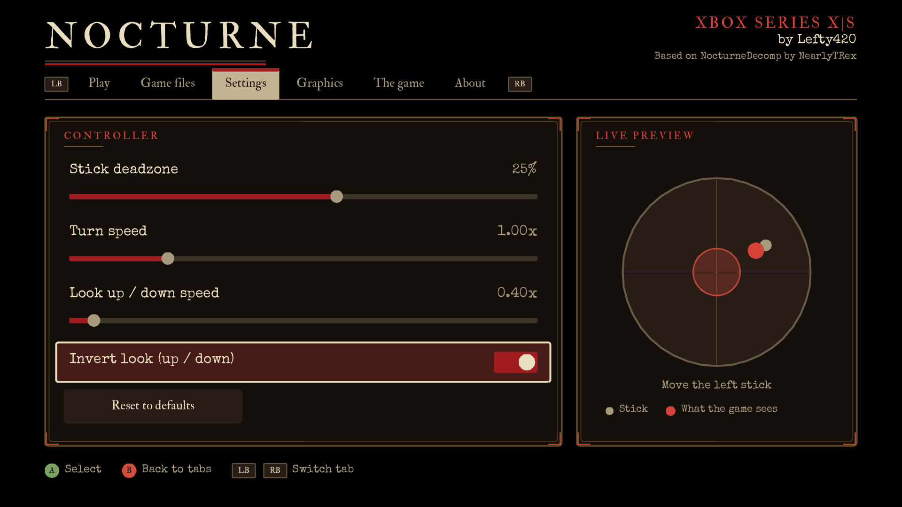
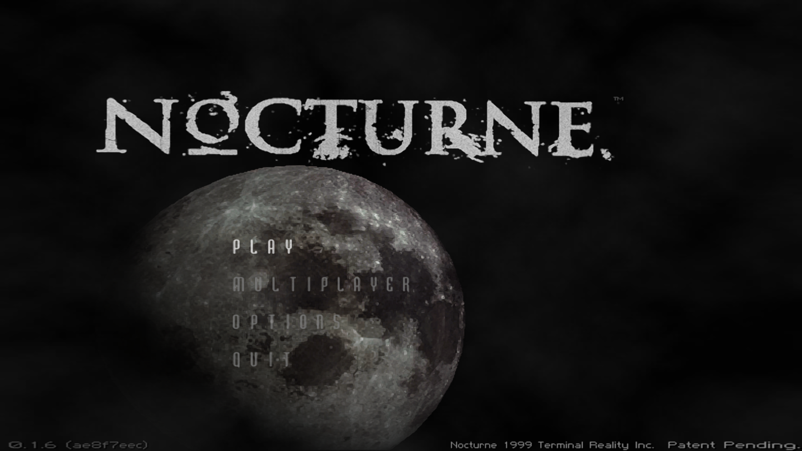
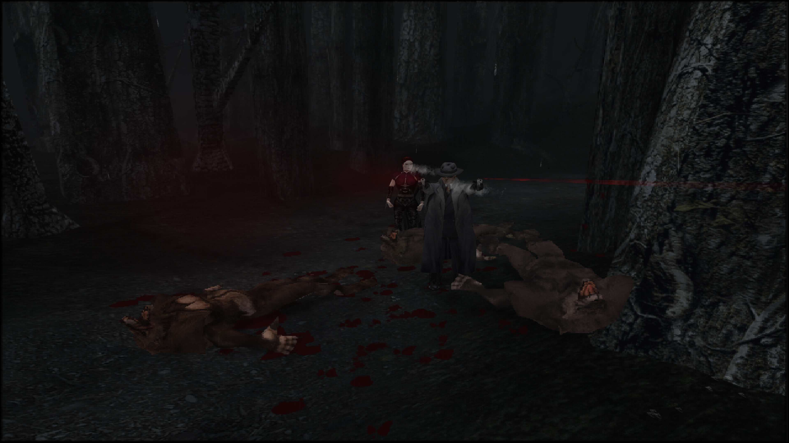

# Nocturne for Xbox Series X|S

An unofficial community port of the *Nocturne* decompilation to a sideloaded Xbox app, with a launcher in front of it.
Made by Lefty420.

**Downloads are on the [Releases page](../../releases).** This repository holds only the downloads and notes.
The code is in [lefty420/NocturneDecomp](https://github.com/lefty420/NocturneDecomp), built on NearlyTRex's
[NocturneDecomp](https://github.com/NearlyTRex/NocturneDecomp).

**No game data is included.** You need your own copy of Nocturne (the retail PC game).

## In game

## Features

All of these are set in the launcher's **Graphics** tab before you press Play.

### Screen shape
The game was made for 4:3 screens, so a wide TV needs a choice about the extra space.

- **4:3**: the game's own shape, with black bars at the sides. Nothing is stretched.
- **Widescreen**: fills the whole screen but stretches the edges more than the middle, so the centre of the picture, where the action is, looks natural.
- **Stretch**: fills the screen evenly. Everything is wider, but nothing is cut off.
- **Zoom**: fills the screen and trims a little off the top and bottom, so the picture stays in proportion.

### Output resolution
- **1080p**: the default. Works on any TV and is the lightest on the console.
- **4K**: sends a 3840×2160 picture. It only helps if your TV and Xbox are set to 4K. The app restarts once when you change it.

### FSR upscaling
The game draws at a low resolution (640×480). **FSR** (AMD FidelityFX Super Resolution) scales that picture up to the output resolution with sharper edges than a plain stretch, so it looks cleaner on a big TV.

- **Sharpness**: a slider from 0 to 100%. Higher is crisper. Lower is softer and more natural.
- 4K with FSR is the heaviest setting. If the frame rate drops, turn FSR off or use 1080p.

### Controller
Dead zone, turn speed, look speed and an invert-look option are set in the launcher's **Settings** tab.

## Install

1. Put the console in **Dev Mode** and open **Device Portal** (`https://<console-ip>:11443`).
2. **Add** → choose `NocturneDecomp.appx` (add `NocturneDev.cer` too if it asks for the certificate).
3. Start the app. In the launcher, open **Game files**, add your Nocturne folders, then press **Play**.

A new version installs over an old one and keeps your saves and settings.

## Getting back to the launcher

After the first time you press **Play**, the app starts straight into the game. To open the launcher again
(for graphics, controls or game files), press and hold **View + Menu + left-stick click** at the same time
while in the game. The app restarts and shows the launcher. Press **Play** to go back into the game, and
the shortcut turns back on.

The B button doesn't close the app. Use **Start** to back out of the game's menus.

## Credits

NearlyTRex (NocturneDecomp), Special Elite (Apache 2.0), IM Fell (OFL), stb libraries (public domain).
